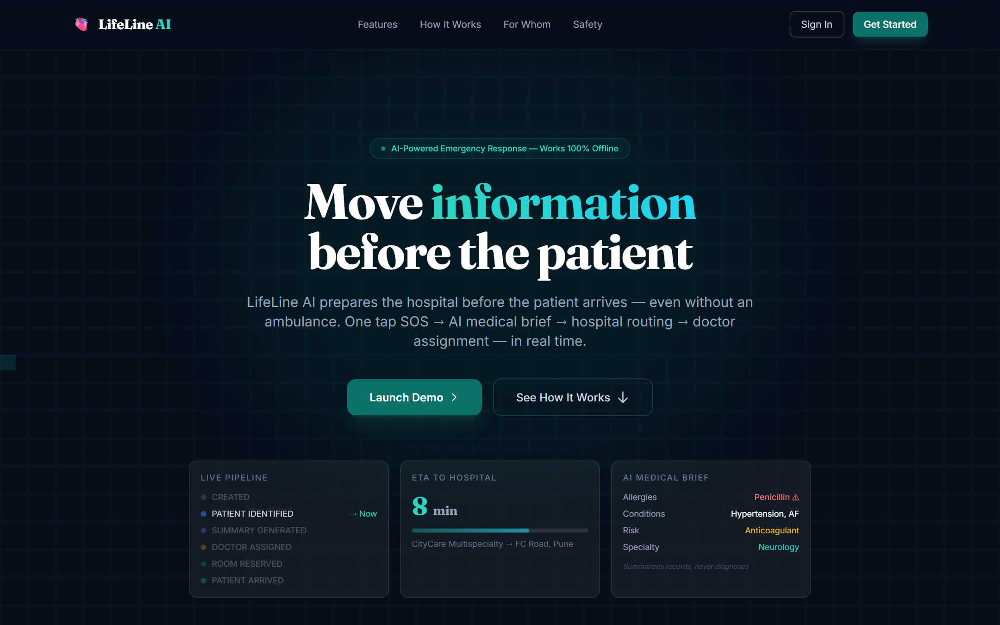
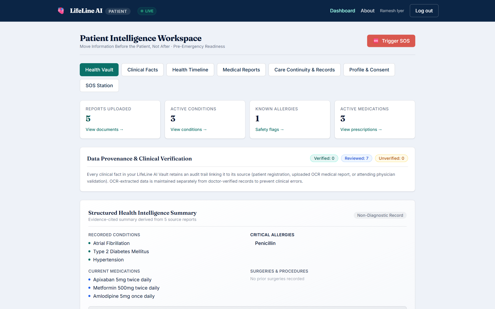
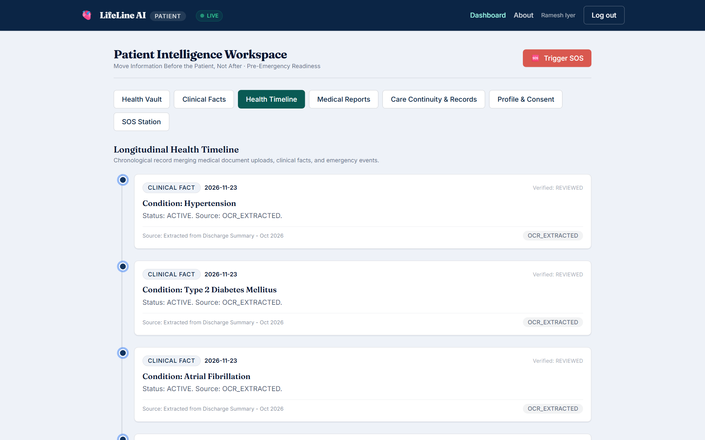
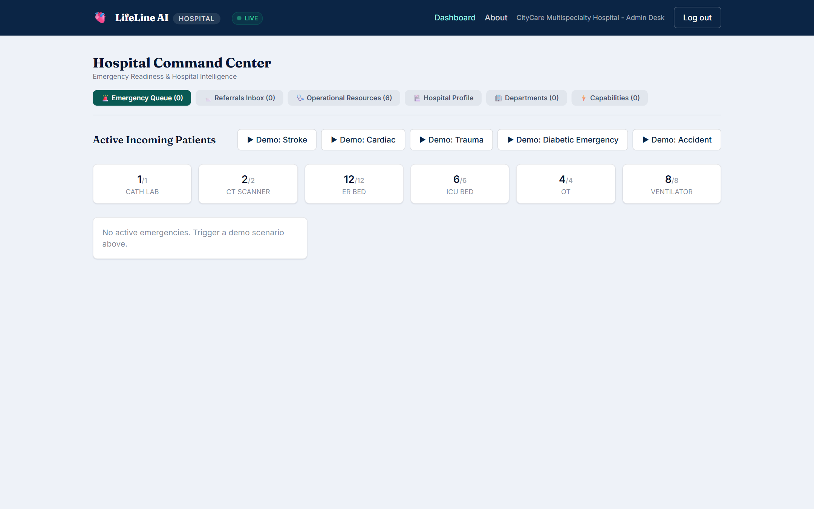
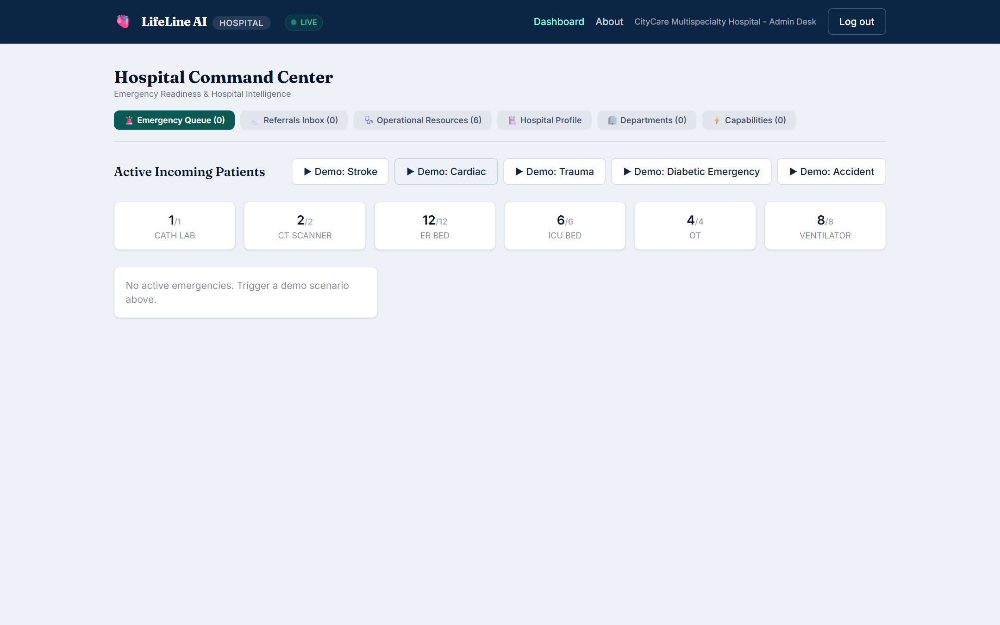
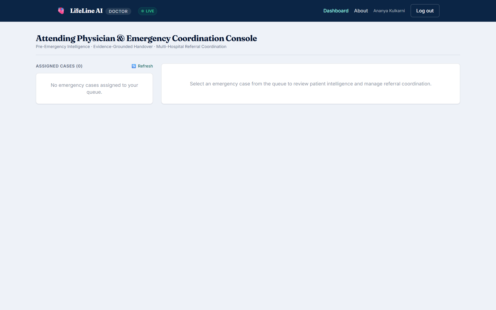
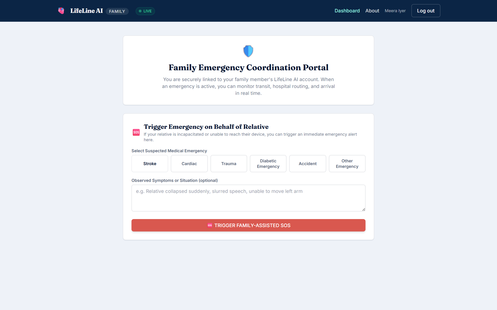

# LifeLine AI — Emergency Healthcare Readiness & Referral Coordination Platform

<div align="center">

[](https://github.com/RutuRaj-1/LifelineAI)
[](https://github.com/RutuRaj-1/LifelineAI)
[-success?style=for-the-badge&logo=pytest)](https://github.com/RutuRaj-1/LifelineAI)
[](https://github.com/RutuRaj-1/LifelineAI)
[](https://github.com/RutuRaj-1/LifelineAI)
[](https://github.com/RutuRaj-1/LifelineAI)

<br/>

### **"Move Information Before the Patient, Not After."**
*Preparing emergency departments, securing critical resources, and streaming evidence-grounded clinical intelligence before the patient arrives — even when there is no ambulance.*

</div>

## 📌 Executive Summary & Clinical Problem

In conventional emergency healthcare systems, critical clinical information moves **behind** the patient. When a patient arrives at an emergency department (ED) without prior coordination:
1. **Zero Pre-Arrival Visibility:** Receiving hospitals have no advance telemetry, no past medical history, and no verified knowledge of existing allergies or medications.
2. **Resource Mismatch & Critical Delays:** Patients suffering acute ST-Elevation Myocardial Infarction (STEMI) or hyper-acute ischemic stroke frequently arrive at facilities with occupied Cath Labs, diverted ICU beds, or off-duty specialists, resulting in catastrophic intra-facility transfer delays.
3. **Administrative & Diagnostic Bottlenecks:** Emergency physicians spend critical minutes taking verbal history from confused bystanders while searching physical paper records.

**LifeLine AI** inverts this paradigm. Through an end-to-end agentic coordination workflow, LifeLine AI captures pre-emergency intelligence, broadcasts multi-hospital referral requests with atomic reservation locks, synthesizes evidence-grounded clinical handover briefs with strict physician approval gates, and maintains longitudinal continuity through discharge synthesis and medication reconciliation.

---

## 📸 Platform Interface & Live Dashboards

### 1. Unified Portal & Role Selector
The platform provides role-tailored workspaces for all stakeholders in the emergency lifecycle: Patients, Attending Physicians, Hospital Triage Supervisors, and Family Bystanders.



---

### 2. Patient Intelligence, Health Vault & Longitudinal Timeline
Patients manage structured clinical facts (conditions, allergies, current medications, surgical history) with OCR document extraction and full provenance tracking. The chronological timeline aggregates clinical visits, verified medications, and approved summaries.

<p align="center">
  
  
</p>

---

### 3. Hospital Readiness & Operational Command Center
Receiving hospitals monitor live emergency intake queues, broadcasted referral requests, and attested operational capacities across ICU Beds, Trauma Bays, and Cath Labs with automated staleness indicators.

<p align="center">
  
  
</p>

---

### 4. Attending Physician Workspace & Clinical Handover
Physicians review pre-hospital incident updates, generate evidence-grounded AI handover briefs, inspect cited document excerpts, and execute formal clinical sign-offs before receiving the patient.



---

### 5. Privacy-Preserving Family Tracking Portal
Family members and bystanders receive live transit updates, hospital destination details, and emergency timeline milestones with strict privacy shielding that conceals internal diagnostic clinical notes.



---

## 🏛️ Core Platform Architecture & Pillars

```
                                      ┌─────────────────────────────────────────┐
                                      │           PATIENT / BYSTANDER           │
                                      │   SOS Trigger + Health Vault Records    │
                                      └────────────────────┬────────────────────┘
                                                           │ (REST / WebSockets)
                                                           ▼
┌──────────────────────────────────────────────────────────────────────────────────────────────────────────────────┐
│                                       LIFELINE AI ORCHESTRATION BACKEND                                          │
│                                                                                                                  │
│  ┌───────────────────────┐   ┌─────────────────────────────┐   ┌───────────────────────┐   ┌──────────────────┐  │
│  │   Health Vault &      │   │  Evidence-Grounded Handover │   │ Referral Broadcasting │   │  Post-Emergency  │  │
│  │   Clinical Facts      ├──►│  AI Summarizer Engine       ├──►│ & Resource Locking    ├──►│  Continuity &    │  │
│  │   (Provenance Engine) │   │  (Non-Diagnostic Safety)    │   │ (Atomic Invariants)   │   │  Medication Rec  │  │
│  └───────────────────────┘   └─────────────────────────────┘   └───────────┬───────────┘   └──────────────────┘  │
└────────────────────────────────────────────────────────────────────────────┼─────────────────────────────────────┘
                                                                             │
                                           ┌─────────────────────────────────┴────────────────────────────────┐
                                           ▼                                                                  ▼
                        ┌──────────────────────────────────────┐                   ┌──────────────────────────────────────┐
                        │      RECEIVING HOSPITAL ALPHA        │                   │       RECEIVING HOSPITAL BETA        │
                        │ Capacity Attested: 8/10 ICU Beds     │                   │ Capacity Attested: 6/10 ICU Beds     │
                        │ Status: ACCEPTED (Hold Locked)       │                   │ Status: CONFLICT (Rejected Atomically│
                        └──────────────────────────────────────┘                   └──────────────────────────────────────┘
```

### 1. Patient Intelligence & Health Vault
- **Longitudinal Fact Tracking:** Stores conditions, allergies, medications, past surgeries, implants, and risk factors.
- **Document OCR Pipeline:** Multi-format ingestion (`.pdf`, `.png`, `.jpg`, `.txt`) using Tesseract OCR with fallback text extractors.
- **Full Provenance Audit:** Every extracted clinical fact maintains immutable provenance metadata (`source_type`, `source_report_id`, `verified_by_user_id`, `extracted_at`).

### 2. Operational Capacity & Staff Attestation
- **Resource Categorization:** Granular tracking of `ICU_BED`, `TRAUMA_BAY`, `VENTILATOR`, `CATH_LAB`, `OR_ROOM`, and `CT_SCANNER`.
- **Staff-Attested Verification:** Real-time operational capacity attested by on-duty nursing supervisors with configurable freshness windows and visual staleness flags (`FRESH`, `STALE`, `EXPIRED`).

### 3. Multi-Hospital Referral Broadcasting & Atomic Locking
- **Parallel Referral Dispatch:** Broadcasts simultaneous referral inquiries across eligible verified receiving hospitals based on specialty capabilities and proximity.
- **Single-Accepted Invariant:** The first hospital to confirm acceptance claims the reservation hold atomically. Any concurrent acceptance attempts by other hospitals immediately receive `HTTP 409 Conflict`, eliminating dual-booking.

### 4. Evidence-Grounded AI Handover & Governance Boundary
- **Non-Diagnostic Safety Mandate:** AI synthesizes documented historical records and field incident reports into a standardized clinical brief. **AI never diagnoses, prescribes, or makes autonomous triage determinations.**
- **Mandatory Physician Gate:** All handovers and discharge summaries require explicit attending physician sign-off (`require_clinical_authority`). Administrative and non-clinical users cannot approve medical documents (`HTTP 403 Forbidden`).
- **Prompt Injection Defense:** Ingested documents containing adversarial text instructions cannot bypass physician sign-off gates or alter clinical safety disclaimers.

### 5. Post-Emergency Continuity & Care Preserving
- **Clinical Outcome Disposition:** Comprehensive disposition tracking (`DISCHARGED`, `ADMITTED`, `TRANSFERRED`) with auditable amendment logging.
- **Medication Reconciliation:** Clinical actions (`CONTINUE`, `START`, `STOP`, `CHANGE`) verified by attending clinicians and automatically promoted to the patient's permanent clinical profile.
- **Outpatient Follow-Up Care Plans:** Structured post-emergency follow-up schedules with direct patient confirmation in the portal.

---

## 🛠️ Technology Stack

| Layer | Technology | Description |
|---|---|---|
| **Frontend** | React 18, TypeScript, Tailwind CSS, Vite | Responsive, accessible SPA with Lucide icons and role-based routing |
| **Backend API** | FastAPI (Python 3.14 / 3.11+), Starlette | High-performance asynchronous REST endpoints with OpenAPI documentation |
| **Database** | SQLite (Dev) / PostgreSQL (Prod), SQLAlchemy 2.0 | Fully relational schema with declarative mappings, check constraints, and CASCADE rules |
| **Schema Migrations** | Alembic | Complete, reversible migration chain (`001 -> 006 -> base -> head`) |
| **Authentication** | JWT (HS256 256-bit), Passlib (Bcrypt) | Role-Based Access Control (`patient`, `doctor`, `hospital`, `family`, `admin`) |
| **Realtime & Cloud** | Native WebSockets & **Firebase / Cloud Firestore** | Dual-channel real-time sync for edge telemetry, hospital availability, and live status streaming |
| **Cloud Storage** | **Firebase Storage** (`lifeline-ai-cdabc.firebasestorage.app`) | Document storage with file-type whitelisting and size boundaries for medical records and discharge cards |
| **AI / NLP** | LangGraph, FAISS, Tesseract OCR | Evidence citation, multi-agent coordination, and deterministic offline mode |
| **Runtime Architecture** | **100% Native Runtime (Zero Docker)** | Clean, lightweight native system footprint with zero container dependencies |

---

### 🔥 Firebase & Cloud Firestore Integration

LifeLine AI connects seamlessly to **Firebase** (`lifeline-ai-cdabc`) for real-time edge telemetry, cloud document storage, and distributed incident reporting:

* **Real-Time Emergency Case Streaming:** Live case location, status transitions (`CREATED` → `ACCEPTED` → `ARRIVED` → `DISCHARGED`), and ETA countdowns are mirrored to the `emergency_cases/{caseId}` Firestore collection.
* **Hospital Capacity Attestation Hub:** Operational capacity metrics across ICU, Trauma, and Cath Lab sync to `hospital_resources/{hospitalId}_{resourceType}` for instant distributed visibility.
* **Bystander Incident Updates:** Field observations and family witness notes sync directly to `incident_reports/{reportId}`.
* **Cloud Storage for Health Vault & Discharges:** Medical reports and official discharge cards upload securely to `gs://lifeline-ai-cdabc.firebasestorage.app/` with 15MB size limits and MIME-type verification.
* **Production Security Rules:** Granular access boundaries are enforced via [`firestore.rules`](firestore.rules) and [`storage.rules`](storage.rules), restricting clinical handovers to licensed physicians and protecting patient records from unauthorized enumeration.

---

## 🚀 Quick Start Guide (Native Execution)

### Prerequisites
- Python 3.11+ (Tested and certified on Python 3.14.2)
- Node.js 18+ & npm (Tested on Node 20 / npm 11)

### 1. Backend Setup
```bash
# Clone the repository
git clone https://github.com/RutuRaj-1/LifelineAI.git
cd LifelineAI

# Create and activate Python virtual environment
python -m venv .venv
source .venv/bin/activate       # On Windows: .venv\Scripts\activate

# Install backend dependencies
pip install -r backend/requirements.txt

# Configure environment variables
cp .env.example .env

# Apply database migrations to head
alembic upgrade head

# Seed initial demonstration dataset (Hospitals, Doctors, Patients, Reports)
python database/seed.py

# Launch FastAPI backend server
uvicorn backend.app.main:app --reload --port 8000
```
*Backend API will be live at `http://localhost:8000`. Interactive Swagger documentation available at `http://localhost:8000/docs`.*

---

### 2. Frontend Setup
```bash
# Open a new terminal session
cd LifelineAI/frontend

# Install dependencies
npm install

# Start Vite development server
npm run dev
```
*Frontend interface will be live at `http://localhost:5173`.*

---

## 🔑 Pre-Seeded Demonstration Accounts

All roles are pre-seeded in the database with instant login buttons on the login screen:

| Role | Email Address | Password | Focus Area |
|---|---|---|---|
| **Patient** | `patient1@lifeline.demo` | `Patient@123` | Health Vault, Medical Profile, SOS Trigger, Timeline |
| **Doctor** | `doctor1@lifeline.demo` | `Doctor@123` | Intake Review, Handover Sign-Off, Med Reconciliation |
| **Hospital Staff** | `hospital1@lifeline.demo` | `Hospital@123` | Queue Dispatch, Resource Attestation, Arrival Confirmation |
| **Family** | `family1@lifeline.demo` | `Family@123` | Privacy-Protected Travel Tracking, Status Updates |

> 💡 **Quick Demo Simulation:** Log into the **Hospital** portal and click any scenario button (**Cardiac**, **Stroke**, **Trauma**, **Diabetic**, **Accident**) to watch an emergency progress live from SOS through referral acceptance, arrival, and discharge.

---

## 🧪 Comprehensive Automated Verification Matrix

Every phase and architectural requirement is validated with automated test suites:

```bash
# Execute the entire backend test suite
pytest backend/tests -v
```

```
============================= test session starts =============================
platform win32 -- Python 3.14.2, pytest-8.4.2
collected 69 items

backend/tests/test_auth.py ................                             [  5%]
backend/tests/test_clinical_authority_rbac.py ...                       [ 10%]
backend/tests/test_db_lifecycle.py .                                    [ 11%]
backend/tests/test_domain_integrity.py ..                               [ 14%]
backend/tests/test_domain_models.py ..                                  [ 17%]
backend/tests/test_emergency_orchestration.py ..........                [ 31%]
backend/tests/test_emergency_pipeline.py .                              [ 33%]
backend/tests/test_hospital_registry.py ........                        [ 44%]
backend/tests/test_operational_resources.py .....                       [ 52%]
backend/tests/test_patient_intelligence.py .......                      [ 62%]
backend/tests/test_pilot_e2e_and_security.py ....                       [ 68%]
backend/tests/test_post_emergency.py ......                             [ 76%]
backend/tests/test_referral_engine.py ............                      [ 94%]
backend/tests/test_referral_integrity.py ...                            [ 98%]
backend/tests/test_migrations.py .                                      [100%]

============================== 69 passed in 40.19s ==============================
```

- **Frontend Compilation:** `npm run build` runs with strict TypeScript checking (`tsc -b && vite build`) and builds in 1.51 seconds with **0 errors and 0 warnings**.
- **Migration Reversibility:** Verified reversible upgrade and downgrade across full Alembic chain (`001 -> 006 -> 001 -> base -> head`).

---

## 🔒 Security & Clinical Governance Highlights

- **Physician-Only Approvals (`require_clinical_authority`):** Administrative accounts (`admin`) cannot approve clinical documents or verify medications. Handover and discharge approvals strictly require active `doctor` credentials.
- **Cross-Patient IDOR Defense:** Enforced multi-tenant isolation ensuring patients cannot enumerate, query, or view medical reports or health vaults of other patients.
- **Multi-Hospital Isolation:** Hospital staff can only modify and attest resources belonging to their assigned facility.
- **Streaming File Whitelist Validation:** Strict file type validation (`.pdf`, `.png`, `.jpg`, `.jpeg`, `.txt`) and 10MB file size limit with streaming chunk inspection to prevent denial-of-service.
- **Prompt Injection Defense:** AI prompt processing remains bounded by deterministic python formatting and immutable clinical governance disclaimers.

---

## 📂 Repository Layout

```
LifeLineAI/
├── .env.example                     # Environment template with native runtime variables
├── PROJECT.md                       # Comprehensive platform architecture & phase documentation
├── README.md                        # Master project documentation & event submission
├── alembic.ini                      # Database migration configuration
├── alembic/                         # Reversible schema revisions (001 through 006)
│   └── versions/
├── backend/
│   ├── app/
│   │   ├── main.py                  # FastAPI application entrypoint & health endpoints
│   │   ├── models.py                # Complete SQLAlchemy relational domain models
│   │   ├── schemas.py               # Pydantic v2 data validation schemas
│   │   ├── security.py              # JWT authentication & clinical RBAC dependencies
│   │   ├── routers/                 # Modular API controllers (Patient, Doctor, Hospital, etc.)
│   │   └── services/                # Business logic, referral engine, and handover services
│   ├── tests/                       # 15 test suites covering 69 unit & integration tests
│   └── requirements.txt             # Python dependencies
├── database/
│   └── seed.py                      # Multi-role demonstration seed script
├── frontend/
│   ├── src/
│   │   ├── pages/                   # Role-specific workspaces (Patient, Doctor, Hospital, Family)
│   │   ├── components/              # Reusable UI widgets, modals, and navigation bars
│   │   └── lib/                     # API client, auth state provider, and WebSockets
│   ├── package.json
│   └── vite.config.ts
└── images/                          # High-resolution platform screenshots
```

---

## 📄 License & Attribution

Developed as an advanced agentic healthcare coordination initiative for academic evaluation and clinical workflow innovation.  
**Core Tagline:** *Move Information Before the Patient, Not After.*  
**Verification Code for Evaluation:** `2J3A5Z`
